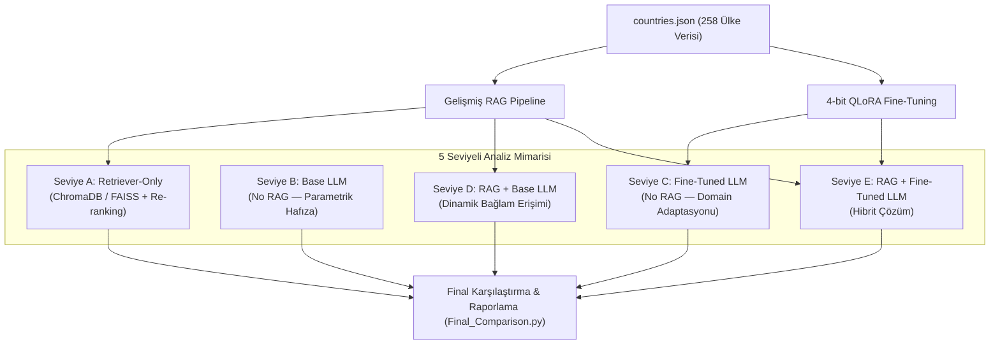

# 🌍 LLM Domain Adaptasyonu ve Bilgi Erişimi: RAG vs Fine-Tuning Kapsamlı Karşılaştırmalı Benchmarkı

[](https://www.python.org/)
[](https://pytorch.org/)
[](https://huggingface.co/)
[](https://www.trychroma.com/)
[](https://github.com/facebookresearch/faiss)
[](https://github.com/artidoro/qlora)

> **Domain:** Countries of the World (CIA World Factbook — 258 Ülke)  
> **Lokal Modeller:** Qwen 2.5 3B, LLaMA-3 8B, Phi-3.5-mini, Gemma-2 2B, Mistral-7B  
> **API Modelleri:** Google Gemini 1.5 Flash, NVIDIA NIM API (LLaMA-3.1-8B, Mistral-7B)  
> **Fine-Tuning:** 4-bit QLoRA (Qwen2.5-3B, LLaMA-3-8B, Phi-3.5)

---

## 📌 1. Proje Özeti (Executive Summary)

Bu çalışma, **parametrik bilgi** (Model İnce Ayarı / Fine-Tuning) ile **parametrik olmayan bilgi** (Geri Getirme Destekli Üretim / Retrieval-Augmented Generation - RAG) yaklaşımlarının domain-spesifik soru-cevaplama (QA) başarısını, halüsinasyon oranını, çıkarım gecikmesini (latency), GPU bellek tüketimini ve birim sorgu maliyetini derinlemesine kıyaslayan akademik ve deneysel bir benchmark projesidir.

Domain verisi olarak CIA World Factbook'tan derlenen **258 bağımsız ülke profili** (`countries.json`) kullanılmıştır. Toplam 120+ kapsamlı test sorusu, 5 stres kategorisi ve 144 farklı geri getirme (retriever) kombinasyonu taranarak 5 ayrı seviyede (Seviye A'dan E'ye) uçtan uca performans ölçümü gerçekleştirilmiştir.

---

## 🏗️ 2. Sistem Mimarisi ve Karşılaştırma Düzeyi (5 Seviye)

Benchmark, aşağıdaki 5 temel seviyeyi aynı test kümesi üzerinde kıyaslar:



- **Seviye A (Retriever-Only):** Üretici dil modeli olmadan, sadece arama katmanının (Hit Rate@k, MRR@k, Recall@k) başarısı.
- **Seviye B (Base LLM — No RAG):** Modelin eğitim öncesi genel dünya bilgisiyle yanıt verme doğruluğu.
- **Seviye C (Fine-Tuned LLM — No RAG):** 4-bit QLoRA ile `countries.json` QA çiftleri üzerinde eğitilmiş modelin tek başına performansı.
- **Seviye D (RAG + Base LLM):** Eğitilmemiş taban modelin en iyi retriever konfigürasyonundan gelen bağlam ile yanıt üretmesi.
- **Seviye E (RAG + Fine-Tuned LLM):** Fine-tune edilmiş modele dinamik RAG bağlamının verilmesiyle elde edilen hibrit mimari.

---

## 🔬 3. Temel Bileşenler ve Metodoloji

### 3.1. Gelişmiş RAG Pipeline
- **3 Chunking Stratejisi:**
  - `sliding_window`: 300 karakter pencere, 150 örtüşme (overlap).
  - `sentence_based`: Cümle sınırlarına duyarlı parçalama (maks. 600 karakter).
  - `hierarchical`: 2 seviyeli (Ülke genel özeti + alt başlık detayları).
- **4 Embedding Modeli:**
  - `intfloat/e5-base-v2` (En iyi performans)
  - `BAAI/bge-base-en-v1.5`
  - `thenlper/gte-base`
  - `sentence-transformers/paraphrase-multilingual-mpnet-base-v2`
- **Top-K & Similarity Threshold Filtering:**
  - $k \in \{1, 7, 15\}$
  - Benzerlik filtreleme eşikleri: $\text{Threshold} \in \{\text{None}, 0.5, 0.7, 0.9\}$
- **Cross-Encoder Re-Ranking:**
  - `cross-encoder/ms-marco-MiniLM-L-6-v2` ile ilk 20 sonuç yeniden skorlanarak bağlam kalitesi artırılmıştır.
- **Vektör Veritabanı Kıyaslaması:**
  - `ChromaDB (HNSW)` ile `FAISS` (IndexFlatL2, IndexFlatIP, IndexIVFFlat, IndexHNSWFlat) indeks türleri karşılaştırılmıştır.

### 3.2. Model Fine-Tuning (4-bit QLoRA)
- **Teknik Detaylar:** BitsAndBytes NF4 kuantizasyon, double quantization, fp16 compute.
- **LoRA Konfigürasyonu:** Rank $r=16$, $\alpha=32$, dropout $0.05$.
- **Model Aileleri:**
  - **Llama 3:** `meta-llama/Meta-Llama-3-8B-Instruct` (Target: `q, k, v, o_proj`)
  - **Qwen:** `Qwen/Qwen2.5-3B-Instruct` (Target: `q, k, v, o_proj`)
  - **Phi:** `microsoft/Phi-3.5-mini-instruct` (Target: `qkv_proj, o_proj`)
- **LoRA Hiperparametre Analizi:** $r \in \{8, 16, 32\}$ karşılaştırması (`Final_LoRA_Config_Comparison.py`).
- **Sentetik Veri Üretimi:** Gemini 1.5 Flash ve NVIDIA API üzerinden LLM destekli yüksek kaliteli QA çiftleri üretilmiştir.

---

## 📊 4. Nihai Karşılaştırma Sonuçları (Benchmark Results)

Aşağıdaki tablo, `final_outputs/final_comparison.csv` dosyasından derlenen birleşik test sonuçlarını göstermektedir:

| Sistem / Seviye | EM | F1 Skoru | Halüsinasyon | Ort. Gecikme (s) | Hız (tok/s) | VRAM (MB) | İnsan Değerl. (Relevance) |
|---|:---:|:---:|:---:|:---:|:---:|:---:|:---:|
| **A — Retriever-Only (e5+hierarchical+k15)** | — | — | — | **0.0025s** | — | **0 MB** | — |
| **Qwen 2.5 3B — E (RAG + FT)** | **0.0583** | **0.6106** | **0.0000** | 4.767s | 5.86 | 3,551 MB | **4.67 / 5.0** |
| **Qwen 2.5 3B — D (RAG + Base)** | **0.0583** | **0.6106** | **0.0000** | 4.774s | 5.84 | 3,551 MB | **4.67 / 5.0** |
| **LLaMA-3 8B — C (FT LLM — No RAG)** | 0.0000 | 0.4707 | 0.1250 | 4.386s | 6.72 | 5,326 MB | 4.28 / 5.0 |
| **LLaMA-3 8B — B (Base LLM)** | 0.0000 | 0.4707 | 0.1250 | 4.389s | 6.71 | 5,326 MB | 4.28 / 5.0 |
| **LLaMA-3 8B — E (RAG + FT)** | 0.0000 | 0.4396 | 0.1000 | 4.219s | 5.82 | 5,326 MB | 4.25 / 5.0 |
| **Gemma 2 2B — D (RAG + Base)** | 0.0000 | 0.3132 | 0.1000 | 1.710s | 14.86 | 3,309 MB | 3.08 / 5.0 |
| **Gemma 2 2B — B (Base LLM)** | 0.0000 | 0.1859 | 0.1000 | 1.996s | 16.61 | 3,309 MB | 3.55 / 5.0 |
| **NVIDIA LLaMA 3.1 8B — RAG** | 0.0000 | 0.2859 | **0.0500** | **0.835s** | **41.57** | API | 3.53 / 5.0 |
| **Mistral 7B — D (RAG + Base)** | 0.0000 | 0.2388 | 0.1250 | 16.986s | 3.98 | 4,006 MB | 3.88 / 5.0 |
| **Mistral 7B — B (Base LLM)** | 0.0000 | 0.1505 | 0.1250 | 16.711s | 4.43 | 4,006 MB | 3.92 / 5.0 |
| **Gemini 1.5 Flash (RAG)** | 0.0000 | 0.0279 | 0.0000 | 0.000s | — | API | 1.77 / 5.0 |

> **Önemli Bulgular:**
> 1. **RAG'ın Gücü:** RAG desteği eklemek küçük modellerde (örneğin Gemma 2B) F1 skorunu **0.1859'dan 0.3132'ye (+%68.5)** çıkarmıştır.
> 2. **Sıfır Halüsinasyon:** Qwen 2.5 3B modelinde RAG eklendiğinde halüsinasyon oranı **%13.3'ten tam olarak %0.0'a** düşmüştür.
> 3. **Retriever Verimliliği:** En iyi retriever (`e5-base-v2` + `hierarchical` + $k=15$) **%100 Hit Rate** ve **0.8222 MRR** değerine yalnızca **2.5 milisaniyede** ulaşmıştır.

---

## 📈 5. Görsel Analizler ve Grafikler

Projede üretilen grafikler `final_outputs/` dizininde yer almaktadır:

| Metrik | Grafik Dosyası | Açıklama |
|---|---|---|
| **EM & F1 Başarısı** | `final_em_f1.png` | Tüm modellerin Seviye B, C, D ve E altındaki F1 skorları |
| **Halüsinasyon Oranı** | `final_hallucination.png` | RAG öncesi ve sonrası uydurma / yanlış bilgi oranı |
| **Gecikme (Latency)** | `final_latency.png` | Model çıkarım süreleri ve token/saniye hızları |
| **İnsan Değerlendirme Radarı** | `final_human_eval_radar.png` | Uygunluk (Relevance), Sadakat (Faithfulness) ve Akıcılık (Fluency) radarı |
| **Bellek & Maliyet** | `final_cost_memory.png` | VRAM tüketimi ve sorgu başı maliyet grafiği |
| **OOD & Stres Testi** | `final_ood_comparison.png` | Kapsam dışı sorularda modellerin direnci |

---

## 📂 6. Repository Dizin Yapısı

Bu depo, GitHub standartlarına uygun olarak modüler ve temiz bir yapıda organize edilmiştir:

```text
├── README.md                      # Ana proje belgelendirmesi
├── requirements.txt               # Gerekli Python kütüphaneleri
├── .gitignore                     # Git tarafından yok sayılacak dosyalar
├── CALISTIRMA_SIRASI.md           # Adım adım Kaggle/Lokal çalıştırma planı
├── DOSYA_ACIKLAMALARI.md          # Tüm Python scriptlerinin detaylı açıklamaları
│
├── data/                          # Veri setleri
│   ├── countries.json             # 258 ülke yapılandırılmış verisi (~9.6 MB)
│   ├── eval_set.json              # 40 soruluk temel değerlendirme kümesi
│   ├── eval_set_extended.json     # 120 soruluk genişletilmiş değerlendirme kümesi
│   └── stress_test_questions.json # 5 kategorili stres testi soruları
│
├── src/                           # Kaynak kodlar (Modüler Python scriptleri)
│   ├── Final_RAG_Pipeline.py      # [1] Gelişmiş RAG boru hattı (Chroma, Embedding, Re-ranking)
│   ├── Final_QLoRA_Finetune_Qwen.py   # [2A] Qwen-3B 4-bit QLoRA eğitimi
│   ├── Final_QLoRA_Finetune_Llama3.py # [2B] LLaMA-3-8B 4-bit QLoRA eğitimi
│   ├── Final_QLoRA_Finetune_Phi35.py  # [2C] Phi-3.5 4-bit QLoRA eğitimi
│   ├── Final_Model_Evaluator.py   # [3] 5 seviyeli değerlendirme motoru
│   ├── Final_Comparison.py        # [4] Sonuçları birleştirme, tablo ve grafik üretimi
│   ├── Final_FAISS_Retriever.py   # [Bonus] FAISS vs ChromaDB kıyaslaması (4 index türü)
│   ├── Final_LoRA_Config_Comparison.py # [Bonus] LoRA rank analizi (r=8, 16, 32)
│   ├── Final_Synthetic_Data_Generator.py # [Bonus] Gemini/NVIDIA ile sentetik QA üretimi
│   ├── Final_Gemini_API_Test.py   # [Opsiyonel] Gemini 1.5 Flash API testi
│   ├── Final_NVIDIA_API_Test.py   # [Opsiyonel] NVIDIA NIM API testi
│   └── Final_Faster_Inference.py  # [Gelişmiş] vLLM / CTranslate2 / ONNX hızlandırma testi
│
├── notebooks/                     # Jupyter Notebook'lar
│   ├── Kaggle_Runner.ipynb        # Uçtan uca Kaggle çalıştırıcı notebook
│   ├── N_llama3_eval.ipynb        # LLaMA-3 değerlendirme notebook'u
│   ├── N_phi_eval.ipynb           # Phi-3.5 değerlendirme notebook'u
│   ├── N_gemma_eval.ipynb         # Gemma-2 değerlendirme notebook'u
│   ├── N_mistral_eval.ipynb       # Mistral-7B değerlendirme notebook'u
│   └── N_final_compare.ipynb      # Final karşılaştırma ve grafik notebook'u
│
└── final_outputs/                 # Deneysel çıktılar, tablolar ve grafikler
    ├── final_comparison.csv       # 10. Bölüm nihai karşılaştırma tablosu
    ├── retriever_results.csv      # 144 retriever kombinasyonunun metrikleri
    ├── pipeline_config.json       # En iyi pipeline ayarları (e5_base + hierarchical + k=15)
    ├── finetune_summary.csv       # Eğitim süreleri ve loss özeti
    ├── final_analysis.md          # Otomatik analiz raporu
    ├── *.png                      # Yüksek çözünürlüklü performans grafikleri
    └── summaries/                 # Model bazlı özet CSV'ler
```

---

## 🚀 7. Kurulum ve Çalıştırma

### 7.1. Gereksinimlerin Kurulması
```bash
git clone https://github.com/<kullanici-adiniz>/<repo-adi>.git
cd <repo-adi>

# Sanal ortam oluşturma (Önerilen)
python -m venv venv
source venv/bin/activate  # Windows için: .\venv\Scripts\activate

# Paketleri kurma
pip install -r requirements.txt
```

### 7.2. Çevre Değişkenleri (API Anahtarları)
API modellerini veya LLaMA gated ağırlıklarını kullanmak için ortam değişkenlerini tanımlayın:
```bash
export HF_TOKEN="<your_hf_token>"               # LLaMA modelleri için zorunlu
export GEMINI_API_KEY="<your_gemini_api_key>"    # Gemini testleri için
export NVIDIA_API_KEY="<your_nvidia_api_key>"    # NVIDIA NIM API için
```
*(Windows PowerShell için `set HF_TOKEN="..."` veya `$env:HF_TOKEN="..."` kullanın).*

---

### 7.3. Adım Adım Çalıştırma Sırası

#### Adım 1: Gelişmiş RAG Pipeline'ı Başlatma
Veriyi indeksler, 4 embedding × 3 chunking × 3 top-k × 4 threshold kombinasyonunu dener ve en iyi konfigürasyonu `pipeline_config.json` olarak kaydeder:
```bash
python src/Final_RAG_Pipeline.py
```

#### Adım 2: Model Fine-Tuning (İsteğe Bağlı / GPU Gerekir)
```bash
# Qwen2.5-3B için QLoRA eğitimi (~45 dk - T4 GPU):
python src/Final_QLoRA_Finetune_Qwen.py

# LLaMA-3-8B için QLoRA eğitimi (~75 dk - T4 GPU):
python src/Final_QLoRA_Finetune_Llama3.py
```

#### Adım 3: 5 Seviyeli Model Değerlendirmesi
Model adını argüman olarak vererek değerlendiriciyi çalıştırın:
```bash
python src/Final_Model_Evaluator.py qwen_3b
python src/Final_Model_Evaluator.py llama3_8b
python src/Final_Model_Evaluator.py gemma_2b
```

#### Adım 4: Nihai Karşılaştırma ve Grafik Üretimi
Tüm model özetlerini birleştirerek nihai kıyaslama tablosunu (`final_comparison.csv`) ve 6 adet görsel grafiği üretir:
```bash
python src/Final_Comparison.py
```

---

## 🧪 8. Kod Doğrulama ve Testler

Depodaki tüm modüllerin syntax bütünlüğü, veri seti tutarlılığı ve metrik hesaplama fonksiyonları otomatik testlerle doğrulanmıştır. Testleri çalıştırmak için:
```bash
python -m unittest scratch/test_suite.py
```

---

## 👥 Katkıda Bulunma ve Lisans

Bu proje akademik ve eğitim amaçlı bir LLM & RAG araştırma çalışmasıdır. MIT Lisansı kapsamında paylaşılmıştır.
Sorularınız ve geri bildirimleriniz için Issue açabilirsiniz.

